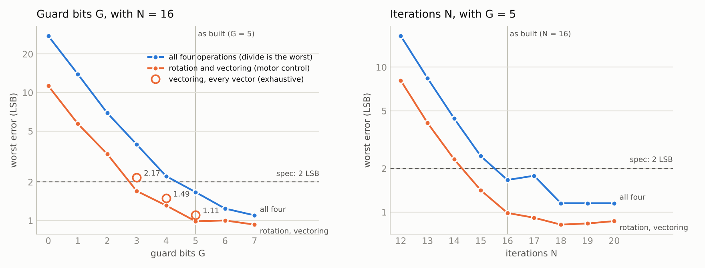

# Fewest guard bits and iterations

How few guard bits G and iterations N still meet the accuracy spec at W = 16? The spec is the one `tb/tb_datatypes.sv` checks: worst error at most 2 LSB for rotation, vectoring (magnitude and angle, |v| ≥ 0.25), multiply and divide, and rotation bias within 0.1 LSB.



## Method

- `python/guard_study.py` runs the bit-exact model (it matches the RTL bit for bit, `python/README.md`) for N = 12 to 20 and G = 0 to 7: 200,000 random rotations and vectorings, 50,000 multiplies and divides, the input ranges of `tb_datatypes`.
- Random vectors can miss the worst case, so for the points near the limit, vectoring is also checked on every input pair in its range (473 million vectors each).
- `tb/tb_guard_bits.sv` repeats the measurement in RTL (400,000 vectors per configuration) and checks it reaches the same verdicts.

## Results (worst error in LSB)

| N | G | Rotation | \|v\| | Angle | Multiply | Divide | All four within 2 LSB | Rotation and vectoring within 2 LSB |
|---|---|---|---|---|---|---|---|---|
| 16 | 5 (as built) | 0.98 | 0.67 | 0.99 (every vector: 1.11) | 1.09 | 1.67 | yes | yes |
| 16 | 4 | 1.22 | 0.86 | 1.31 (every vector: 1.49) | 1.31 | 2.22 | no (divide) | yes |
| 16 | 3 | 1.59 | 1.24 | 1.70 (every vector: 2.17) | 1.63 | 3.93 | no | no (angle 2.17 on the exhaustive check) |
| 15 | 5 | 1.42 | 0.67 | 1.28 | 1.54 | 2.44 | no (divide) | yes |
| 15 | 4 | 1.63 | 0.80 | 1.40 (every vector: 1.79) | 1.70 | 2.95 | no | yes |
| 14 | 5 | 2.32 | 0.65 | 1.90 | 2.50 | 4.44 | no | no (rotation) |

Bias stays under 0.01 LSB in every row.

## What it shows

1. **For all four operations, the built design is already the smallest:** N = 16 and G = 5. One guard bit fewer, or one iteration fewer, and divide goes past 2 LSB. Divide is always the worst operation, because its error is scaled by 1/x (up to 2 for x ≥ 0.5).
2. **Motor control needs only rotation and vectoring, and those meet the spec with G = 4** (with N = 16, or N = 15). G = 3 looks fine on 2 million random vectors (1.90 LSB) but an exhaustive check finds angles 2.17 LSB off, so it does not meet the spec.
3. **What one guard bit saves** (same flow as `docs/pipeline_ppa.md`):

| Design | Guard bits | Area (um²) | Flops | Fastest clock | Energy per result |
|---|---|---|---|---|---|
| Iterative | 5 | 5,362 | 80 | 425 MHz | 112.6 pJ |
| Iterative | 4 | 5,107 (-4.8%) | 77 | 434 MHz | 107.7 pJ (-4.4%) |
| Pipeline, 18 ranks | 5 | 24,012 | 1,495 | 912 MHz | 38.5 pJ |
| Pipeline, 18 ranks | 4 | 22,749 (-5.3%) | 1,448 | 928 MHz | 36.4 pJ (-5.5%) |

The motor-control simulation passes the same checks with G = 4 (`tb_foc.sv -GG=4`, regression test K4).

## Reproduce

```sh
python3 python/guard_study.py --png docs/guard_study.png      # the grid (about 20 s)
python3 python/guard_study.py --exhaustive 3,4,5              # every vector, N = 16 (about 3 minutes each)
python3 python/guard_study.py --exhaustive 4 --n 15
python3 scripts/regress.py --only Q                           # the RTL check
```
