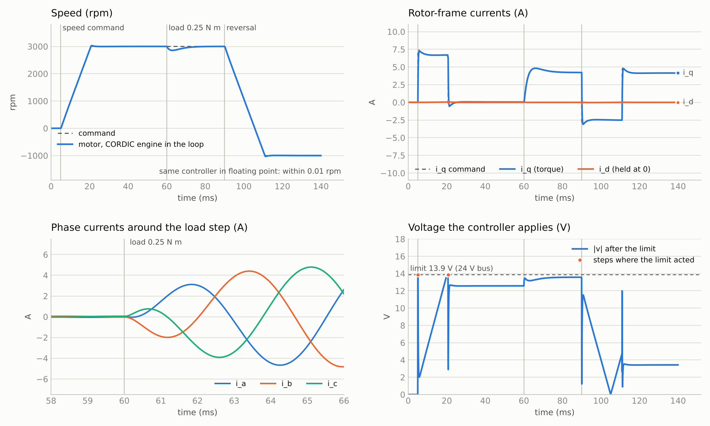

# Motor control with the CORDIC engines in the loop

`tb/tb_foc.sv` runs field-oriented control (FOC) of a permanent-magnet motor with both engines in the loop. The motor, the current sensor, the encoder and the PI controllers are real math in the testbench; every transform goes through the hardware.

## Each 50 us control step

| # | Operation | Engine mode | In | Out |
|---|---|---|---|---|
| 1 | Park | rotation by -θ | i_α, i_β (from the phase currents), θ from the encoder | i_d, i_q |
| 2 | Voltage limit | vectoring | v_d, v_q from the PI controllers | \|v\| and its angle φ |
| 3 | Inverse Park | rotation by φ + θ | (min(\|v\|, V_max), 0) | v_α, v_β to the inverter |

Step 3 does the limit and the inverse Park in one rotation: the voltage keeps its angle and only its length is clamped. The iterative engine (`cordic_ss`) and the pipelined engine (`cordic_pipe`, 18 ranks) get every operation on the same clock, and the testbench requires identical results. The same controller also runs in floating point on its own copy of the motor.

## Setup

| | |
|---|---|
| Motor | 24 V PMSM: R = 0.2 Ω, L_d = L_q = 0.4 mH, ψ = 0.01 Wb, 4 pole pairs, J = 2e-5 kg m² |
| Drive | V_max = 24 V / √3 = 13.9 V, current limit 10 A, 20 kHz control (50 us) |
| Controller | current loops 1 kHz (PI zero on R/L, with decoupling), speed loop 100 Hz with the ramp's acceleration current fed forward |
| Fixed point | W = 16: currents 1.0 = 10 A, voltages 1.0 = 20 V, angles 2^16 = 360° |
| Scenario | speed command 0 → 3000 rpm at 5 ms (ramp 20,000 rad/s²), load 0.25 N m at 60 ms, reversal to -1000 rpm at 90 ms, end at 140 ms |

## Results

| Check | Result |
|---|---|
| Both engines identical, 8,400 operations | 0 different |
| Worst error against real math (same quantized inputs) | Park 0.83, \|v\| 0.61, angle 1.08, inverse Park 0.82 LSB |
| Speed at the end of each phase | 3000.00, 2999.65 (under load), -999.96 rpm |
| i_d in steady state | within 0.001 A of 0 |
| Hardware loop against the floating-point loop | speed within 0.01 rpm, i_q within 0.001 A |
| Voltage limit | acts in 13 steps: at the first step and at the end of the 3000 rpm ramp, where the back-EMF takes most of the 13.9 V |
| Same loop with one guard bit fewer (G = 4, `-GG=4`) | passes the same checks |
| `python/foc_sim.py` (bit-exact model in place of the RTL) | reproduces the RTL's log line for line (2,801 lines, 0 different) |

## Which engine for motor control

| | Iterative | Pipelined, 18 ranks |
|---|---|---|
| Clocks per operation | 17 | 19 |
| Clocks per control step (3 dependent operations) | 51 | 57 |
| Time per step at the fastest clock (425 and 912 MHz) | 120 ns | 62.5 ns |
| Share of the 50 us period | 0.24% | 0.13% |
| Area | 5,362 um² | 24,012 um² |

The three operations of a step depend on each other, so latency sets the step time and the pipeline's one-result-per-clock does not help one motor. One iterative engine serves one motor with 99.8% of its time to spare. The pipeline pays off when many independent operations share it: it finishes an operation every clock, so one pipelined engine could do the transforms for many motors (or channels) in the same period, where the iterative design would need one engine each.

## Files

| File | |
|---|---|
| `tb/tb_foc.sv` | the simulation (parameters W, N, G, CUTS; `+CSV=<file>` for the log) |
| `docs/foc_rtl.csv` | its log, one row per control step |
| `python/foc_sim.py` | the same loop with the bit-exact model |
| `python/plot_foc.py` | the chart above |
