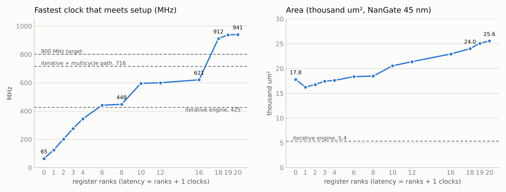

# Pipelined engine: design, verification, constraints and PPA

W = 16, N = 16, the NanGate 45 nm open cell library (typical corner), synthesis only. These numbers compare the designs with each other; the final numbers for the report come from Fusion Compiler with the school library, using the same SDC files.

## Summary

- `cordic_pipe` takes a new operation every clock and gives the same results as `cordic_ss`, bit for bit. Checked on every input at W = 8 (67,108,864 operations), on random and corner inputs at W = 6, 8 and 16, at all 13 pipeline depths, and on the synthesized gate-level netlists of the key designs.
- **Before / after:** the clock goes from 425 MHz to 912 MHz and throughput from 25 million to 912 million results per second, for 4.5 times the area. At the 800 MHz target the iterative engine fails by 0.827 ns; the pipeline with 18 register ranks meets it with 0.154 ns to spare.
- **Stalls:** valid/ready on both sides. A stalled consumer holds the whole pipeline; nothing is lost, repeated or reordered, and in_ready comes from a flop. Stall support costs 18% more area and 10% more power, and no clock speed.
- **Exceptions:** the pipeline has no false or multicycle paths, and the SDC says why. The iterative engine gets a real multicycle path with `OUT_WAIT = 1` (one extra clock before out_valid): 425 to 716 MHz for one clock of latency and almost no area.
- **The ×K "multiplier"** was the slowest stage (748 MHz). Splitting it into a carry-save tree and one add took the pipeline to 941 MHz; the limit is now one CORDIC iteration per stage.

## The pipelined engine (`rtl/cordic_pipe.sv`)

- Every iteration has its own add/subs with a fixed shift and a fixed angle: no barrel shifter, no angle table mux, no input mux.
- Every operation carries its own mode bits, overflow flag and tag down the pipeline, so the mode can change on every clock.
- Linear operations pass through the i = 0 stage unchanged (linear mode starts at i = 1), so every operation has the same latency and results leave in order.
- ×K is written in non-adjacent form (digits +1, 0, -1): 7 shifted copies instead of 10. A carry-save tree (`rtl/csa_tree.sv`) reduces them to two numbers, and the one carry-propagate add can sit in the next stage. The integer result is exactly the iterative engine's sum.
- `CUTS` chooses which of the 20 cut points get a register rank: after the input stage, after each iteration, after the ×K carry-save tree, after the ×K add, after rounding. The output register is always there, so latency = (number of ranks) + 1 clocks. `syn/balance.py` picks, for each number of ranks, the cut points that make the slowest stage as fast as possible.
- `pipe_cut.sv` is one rank. `STALL = 0` removes the stall support, only to measure its cost.

## Stalls and hazards

- **Handshake.** An operation is taken on a clock with `in_valid && in_ready`, a result on a clock with `out_valid && out_ready` (AXI-Stream rules). A result left waiting holds its value and tag.
- **Downstream stall.** All ranks share one enable. When the consumer stops, the 2-entry skid buffer at the output catches the one result already on its way, then in_ready drops and everything holds. Because in_ready comes straight from a flop (it means "the skid entry is empty"), there is no combinational path from out_ready to in_ready, so stalls can chain through other pipelines without long paths or combinational loops, and the enable that reaches all ~1,500 flops starts at a flop.
- **Upstream gaps.** Clocks without an operation (bubbles) need nothing special. Data registers load only for real operations, so empty stages do not toggle.
- **Data hazards.** None inside: operations never feed each other, unlike the iterative engine, which has to finish before it can take the next one. An operation that needs an earlier result (inverse Park after Park and PI, say) is a hazard outside the engine: the requester waits until that result comes out, and the tag tells it which result is which. J8 does exactly this with 1 to 2 L interleaved chains. One chain gets one result every L + 1 clocks; L + 1 or more chains fill the pipeline (0.99 results per clock).
- **Loops.** If a consumer feeds results back into the engine (PI, then inverse Park), the loop must not hold more operations than it can store, or every stage ends up waiting on the next. The requester's tag count gives that credit.

## Same results as the iterative engine

| Check | What | Result |
|---|---|---|
| J1, J2 | 40,000 random operations and 6,912 corner inputs, all four modes, bit for bit against `cordic_ss` (x, y, z, ovf, tag) | identical |
| J3 | Latency L = ranks + 1, then one result per clock | pass |
| J4, J5 | 40,000 operations with 30% bubbles and 30% stalls; a stalled result holds | nothing lost, repeated or reordered |
| J6 | out_ready low for 3 L clocks while inputs keep coming | takes exactly L + 1, then in_ready drops, drains in order |
| J7 | Reset with operations in flight | nothing comes out afterwards |
| J8, J9 | Dependent chains with random stalls; tags | identical, every tag right |
| J10 | Every input in all 4 modes at W = 8 | 67,108,864 operations identical |
| All depths | J1 to J9 at each of the 13 depths in the sweep | identical |
| Gate level | The synthesized netlists of both iterative engines, the 18- and 20-rank pipelines, the no-stall pipeline and the multiplier design, each running next to its RTL for 2,000 clocks (`syn/tb_power.sv`) | identical |
| Mutation | 7 deliberate bugs (skid buffer, rounding, linear skip, zero vector, in_ready, carry-save carry, a ×K digit's sign) | every one caught |
| D10 | `cordic_ss` with `OUT_WAIT = 1` against `OUT_WAIT = 0`, 2,000 operations | identical, one clock later |

All earlier groups (A to I) still pass.

## Timing constraints (`syn/*.sdc`)

Plain SDC, so the same files work in OpenSTA, Design Compiler, Fusion Compiler and PrimeTime.

| Constraint | Value | Why |
|---|---|---|
| `create_clock` | `CLK_PERIOD` (1.25 ns for the 800 MHz target) | the target |
| `set_clock_uncertainty` | 50 ps setup, 20 ps hold | jitter plus the skew the clock tree will add |
| `set_clock_transition` | 40 ps | the clock is ideal before clock tree synthesis |
| `set_input_delay` | max 25% of the period, min 50 ps | inputs come from flops in the next block through a little logic; the earliest is a flop's clock-to-Q |
| `set_output_delay` | max 25% of the period, min 0 | outputs go to flops in the next block |
| `set_driving_cell` | `DFF_X1/Q` (SAED32: `DFFX1_RVT`) | a real driver instead of an ideal one |
| `set_load` | 3 fF | about three flop inputs plus wire |
| `set_max_transition` | 0.2 ns | the library's default limit |
| reset | timed like any other input | it is synchronous, so it must reach every flop in one clock |

`check_setup` is clean on every design: every flop is clocked, every input and output is constrained, no combinational loops. The only design-rule flags are a few nets slightly over a gate's maximum capacitance in some of the intermediate depths (ABC does not enforce that limit; a commercial flow fixes it during compile); the iterative engines and the 18 to 20 rank pipelines have none.

## Multicycle and false paths

**Multicycle path (iterative engine, `OUT_WAIT = 1`).** With `OUT_WAIT = 1` the FSM goes EXE, HOLD, DONE: the lane registers take their last value when HOLD starts and keep it through HOLD and DONE, and out_valid is high only in DONE. Everything that reads the result (the consumer, and `ovf_hold` through `sat`) samples it only in DONE, so the ×K, rounding and saturation path has two clocks. `syn/cordic_ss_mcp.sdc`:

```tcl
set mcp_pins [get_pins {u_error_correction/x[*] u_error_correction/y[*] u_error_correction/z[*]}]
set_multicycle_path 2 -setup -through $mcp_pins
set_multicycle_path 1 -hold  -through $mcp_pins
```

- `-setup 2` checks setup at the second clock; `-hold 1` moves the hold check back to the launch clock, where a one-clock path has it. Without it, hold would be checked a clock late and fail everywhere.
- `-through` the output stage's data pins, not `-from` the lane registers: the same registers feed the next iteration and the lane-overflow flag, which are real one-clock paths and must stay checked. The output stage's `out_valid` and `scale_en` pins come from the FSM and change when DONE starts, so they keep one clock too.
- The output stage must stay its own block for those pins to exist (Yosys `keep_hierarchy`; in Design Compiler or Fusion Compiler, do not ungroup `u_error_correction`).
- OpenSTA confirms it: at 1.25 ns, setup through those pins is checked at 2.5 ns (+0.423 ns slack), hold at 0 ns (+0.148 ns), and the select path through `out_valid` still at 1.25 ns (+0.139 ns).
- The same hardware timed without the exception is still 425 MHz: the extra clock only helps once the constraint tells the tool it exists. With it, the engine reaches 716 MHz, limited by its iteration loop (a real one-clock path).
- Only valid with `OUT_WAIT = 1`. With `OUT_WAIT = 0` the lanes hold for one clock only, and the same exception would hide real violations.

**No multicycle paths in the pipeline.** Every rank loads on every clock the pipeline moves, so every path starts and ends on consecutive clocks. A stall holds the registers, but the clock after it ends the data moves on, so stalls do not relax anything.

**No false paths.** A false path is one no operation can ever exercise. The candidates, and why none is false:

| Candidate | Why it is timed |
|---|---|
| Mode-specific logic (×K only for circular, 2^-i angles only for linear, the i = 0 stage skipped by linear) | every such path is used by some operation, and the mode changes every clock |
| Reset | synchronous: it must reach every valid flop in the same clock |
| out_ready to in_ready | no such path: in_ready comes from a flop |
| Tags | a plain register chain; short, but real |
| Configuration | WIDTH, ITER, G and CUTS are parameters fixed at build time, not signals |
| Clock crossings | one clock |

Declaring any of these false would only hide real violations, so the SDC has no `set_false_path`.

## Results

### Before and after

| Design | Latency | Results per clock | Fastest clock | Slack at 800 MHz | Results per second at the fastest clock | Area (um²) | Flops | Power at 800 MHz, full load | Energy per result |
|---|---|---|---|---|---|---|---|---|---|
| Iterative engine (main) | 17 clocks | 1/17 | 425 MHz (2.353 ns) | -0.827 ns (fails) | 25 M | 5,362 | 80 | 5.3 mW | 112.6 pJ |
| Iterative, 2-clock output stage (multicycle path) | 18 clocks | 1/18 | 716 MHz (1.396 ns) | -0.146 ns (fails) | 40 M | 5,368 | 81 | 5.0 mW | 111.8 pJ |
| Pipeline, 18 ranks (fewest that meet 800 MHz) | 19 clocks | 1 | 912 MHz (1.096 ns) | +0.154 ns (meets) | 912 M | 24,012 | 1,495 | 30.7 mW | 38.5 pJ |

### Adding register ranks



Each row places its ranks where they balance the stages best (`syn/balance.py`). Latency in ns is latency × period.

| Ranks | Latency | Fastest clock | Period | Change in period | Latency in ns | Area (um²) | Flops | Worst path, start -> end |
|---|---|---|---|---|---|---|---|---|
| 0 | 1 | 65 MHz | 15.391 ns |  | 15.4 | 17,821 | 108 | `z_in[14]` -> `ovf_reg` |
| 1 | 2 | 125 MHz | 8.005 ns | -48% | 16.0 | 16,261 | 186 | `y_in[2]` -> `g_cut_7_u_cut_q_73_reg` |
| 2 | 3 | 202 MHz | 4.958 ns | -38% | 14.9 | 16,773 | 264 | `g_cut_10_u_cut_d_76_reg` -> `g_cut_11_u_cut_q_73_reg` |
| 3 | 4 | 276 MHz | 3.618 ns | -27% | 14.5 | 17,447 | 338 | `g_cut_10_u_cut_d_75_reg` -> `g_cut_13_u_cut_q_73_reg` |
| 4 | 5 | 345 MHz | 2.898 ns | -20% | 14.5 | 17,608 | 411 | `g_cut_10_u_cut_q_76_reg` -> `g_cut_14_u_cut_q_73_reg` |
| 6 | 7 | 441 MHz | 2.267 ns | -22% | 15.9 | 18,373 | 559 | `g_cut_10_u_cut_q_75_reg` -> `g_cut_13_u_cut_q_73_reg` |
| 8 | 9 | 448 MHz | 2.234 ns | -1% | 20.1 | 18,474 | 711 | `g_cut_13_u_cut_q_76_reg` -> `cs_d_195_reg` |
| 10 | 11 | 596 MHz | 1.678 ns | -25% | 18.5 | 20,549 | 969 | `g_cut_6_u_cut_q_76_reg` -> `g_cut_8_u_cut_q_73_reg` |
| 12 | 13 | 600 MHz | 1.667 ns | -1% | 21.7 | 21,391 | 1,125 | `g_cut_13_u_cut_q_75_reg` -> `g_cut_15_u_cut_q_73_reg` |
| 16 | 17 | 621 MHz | 1.611 ns | -3% | 27.4 | 22,940 | 1,418 | `g_cut_5_u_cut_q_28_reg` -> `g_cut_7_u_cut_q_73_reg` |
| 18 | 19 | 912 MHz | 1.096 ns | -32% | 20.8 | 24,012 | 1,495 | `g_cut_11_u_cut_q_76_reg` -> `g_cut_12_u_cut_q_73_reg` |
| 19 | 20 | 937 MHz | 1.067 ns | -3% | 21.3 | 25,095 | 1,682 | `g_cut_10_u_cut_d_76_reg` -> `g_cut_10_u_cut_q_73_reg` |
| 20 | 21 | 941 MHz | 1.063 ns | 0% | 22.3 | 25,562 | 1,748 | `g_cut_10_u_cut_d_76_reg` -> `g_cut_10_u_cut_q_73_reg` |

- The first ranks pay off almost fully: 1, 2 and 4 ranks cut the period by 48%, 38% and 20%. A rank costs only about 0.2 ns (clock-to-Q, setup, clock uncertainty) against nanoseconds of logic.
- A rank only helps if it splits the slowest stage. From 6 to 8 and from 10 to 16 ranks the clock barely moves, because some stage still holds two iterations.
- At 18 ranks every iteration has its own stage: 621 to 912 MHz. 19 and 20 ranks split the output stage further and gain 3%.
- The floor is one iteration per stage: about 0.85 ns of logic plus the 0.2 ns overhead. Each iteration needs the sign of the one before, which needs a full carry-propagate add, so more registers cannot get below it without changing the arithmetic.
- Latency grows by one clock per rank, but in nanoseconds the 18-rank pipeline (20.8 ns) is faster than the iterative engine (17 × 2.353 = 40 ns).
- Area: unrolling alone more than triples it (17.8k with no registers against 5.4k); the registers add up to 8k more.
- Flop names in the last column: `g_cut_<j>_u_cut_q_<bit>_reg` is a bit of the rank after cut point j (bit 76 is the mode bit cl, 75 is rv, 73 the overflow flag); a `_d_` name is the same kind of flop, named after the next rank's input.

### What stall support costs

Both have a register at every cut point; only the stall logic differs.

| | Area (um²) | Flops | Fastest clock | Power, full load | Power, 1 result every 17 clocks |
|---|---|---|---|---|---|
| With stalls (valid/ready, skid buffer) | 25,562 | 1,748 | 941 MHz | 32.6 mW | 8.2 mW |
| Without (in_ready = 1, out_ready ignored) | 21,705 | 1,694 | 916 MHz | 29.6 mW | 7.4 mW |
| Cost | +3,857 (+18%) | +54 | none (within mapping noise) | +10% | +11% |

The enable muxes cost the area and the power. The data registers only load for real operations, but that saves nothing here: between operations the inputs hold their values, so the empty stages would not toggle anyway.

### Power (800 MHz, rotations, every net's activity from a gate-level simulation)

| Design | Load | Results in 2,000 clocks | Total | Flops' share | Leakage | Energy per result | Gate level vs RTL |
|---|---|---|---|---|---|---|---|
| Iterative | back to back (1 per 17 or 18 clocks) | 118 | 5.32 mW | 12% | 0.12 mW | 112.6 pJ | match |
| Iterative, multicycle | back to back (1 per 17 or 18 clocks) | 111 | 4.96 mW | 13% | 0.12 mW | 111.8 pJ | match |
| Pipeline, 18 ranks | 1 per clock | 1,997 | 30.74 mW | 40% | 0.51 mW | 38.5 pJ | match |
| Pipeline, 18 ranks | 1 per 17 clocks | 117 | 7.21 mW | 76% | 0.52 mW | 154.2 pJ | match |
| Pipeline, 20 ranks | 1 per clock | 1,997 | 32.57 mW | 44% | 0.54 mW | 40.8 pJ | match |
| Pipeline, 20 ranks | 1 per 17 clocks | 117 | 8.24 mW | 79% | 0.54 mW | 176.0 pJ | match |
| Pipeline, no stall support | 1 per clock | 1,997 | 29.56 mW | 46% | 0.46 mW | 37.0 pJ | match |
| Pipeline, no stall support | 1 per 17 clocks | 117 | 7.43 mW | 83% | 0.46 mW | 158.7 pJ | match |
| Multipliers + table | 1 per clock | 1,997 | 21.56 mW | 19% | 0.38 mW | 27.0 pJ | match |
| Multipliers + table | 1 per 17 clocks | 117 | 3.20 mW | 57% | 0.38 mW | 68.3 pJ | match |

- At full load the pipeline spends 38.5 pJ per result, a third of the iterative engine's 112.6 pJ. The iterative engine clocks its whole datapath 17 times per result, and its output stage recomputes ×K on every clock while the lanes change.
- At the iterative engine's rate (one result every 17 clocks) the pipeline is worse: 154 pJ per result, because about 1,500 flops are clocked every cycle while doing nothing (76% of its power). Clock gating on the rank enables, which Fusion Compiler can insert, would cut much of that.
- Leakage is about 2% of the total at full load and 7% to 12% at low load, where switching drops.

### The ×K step (the multiplier question)

- There is no general multiplier anywhere. ×K (K ≈ 0.607) multiplies by a constant: shifted copies of x added together.
- In the iterative engine, ×K, rounding and saturation are the critical path (1.715 ns arrival; the rest of the 2.353 ns period is the output budget and clock uncertainty).
- In the pipeline, ×K as one stage (10 shifted copies) held the clock at 748 MHz. With 7 copies in a carry-save tree and the one add in the next stage, the two ×K stages take 0.62 and 0.76 ns, and the clock reaches 941 MHz (+26%).

### CORDIC against multipliers (rotation)

| | Iterative CORDIC | Pipelined CORDIC, 18 ranks | Multipliers + sine table |
|---|---|---|---|
| Operations | rotation, vectoring (magnitude, atan2), multiply, divide | same | rotation only |
| Area (um²) | 5,362 | 24,012 | 16,221 |
| Flops | 80 | 1,495 | 511 |
| Latency | 17 clocks | 19 clocks | 6 clocks |
| Results per clock | 1/17 | 1 | 1 |
| Fastest clock | 425 MHz (716 with the multicycle path) | 912 MHz | 772 MHz |
| Energy per rotation, full load, 800 MHz | 113 pJ | 38.5 pJ | 27.0 pJ |
| Power at 1 rotation every 17 clocks | 5.3 mW | 7.2 mW | 3.2 mW |
| Worst error, 100,000 random rotations | 1.29 LSB | 1.29 LSB | 1.00 LSB |

For the report and the slides:

1. **For rotation alone, multipliers win.** At one result per clock the multiplier design uses 32% less area and 30% less energy, has 6 clocks of latency instead of 19, and is slightly more accurate. (It misses 800 MHz by 44 ps in its interpolation stage; one more register there should fix that.)
2. **CORDIC earns its place by doing everything FOC needs in one adder-only datapath:** Park and inverse Park (rotation), magnitude and angle for voltage limiting and the SVPWM sector (vectoring), multiply and divide. The multiplier design does rotation only; vectoring would need a divider and a square root, or more tables.
3. **At FOC's rate the small engine is enough.** FOC needs a few rotations per 50 µs control period, so the iterative engine is far more than fast enough, and at 5.4k um² it is a third the size of the multiplier rotator. (The multiplier design still uses less power at the same rate: 3.2 mW against 5.3 mW.)
4. **Precision scales differently.** CORDIC adds one iteration per extra bit; a linearly interpolated sine table doubles every 2 extra bits, or needs higher-order interpolation with more multipliers.

The multiplier design is in `compare/` (`mult_rot.sv`, table from `gen_sin_table.py`); `compare/tb_mult_rot.sv` measures both designs' errors on the same 100,000 rotations.

### One guard bit fewer

Motor control uses only rotation and vectoring, which stay within 2 LSB with G = 4 (`docs/guard_bits.md`). One guard bit fewer, same structure:

| Design | Guard bits | Area (um²) | Flops | Fastest clock | Power at 800 MHz, full load | Energy per result |
|---|---|---|---|---|---|---|
| Iterative | 5 | 5,362 | 80 | 425 MHz | 5.32 mW | 112.6 pJ |
| Iterative | 4 | 5,107 | 77 | 434 MHz | 5.08 mW | 107.7 pJ |
| Pipeline, 18 ranks | 5 | 24,012 | 1,495 | 912 MHz | 30.74 mW | 38.5 pJ |
| Pipeline, 18 ranks | 4 | 22,749 | 1,448 | 928 MHz | 29.07 mW | 36.4 pJ |
| Iterative: change | | -4.8% | -3 | +2% | -4.4% | -4.4% |
| Pipeline: change | | -5.3% | -47 | +2% | -5.5% | -5.5% |

## How the numbers were made

- **Synthesis:** Yosys 0.70 (yowasp-yosys) with the slang SystemVerilog frontend, `synth -flatten -noabc`, then ABC mapping to the library with a delay-oriented script (`syn/run_ppa.py`). Yosys's default ABC scripts optimize for area first and turn its Brent-Kung adders into ripple-carry chains (a registered 42-bit add needed a 1.24 ns clock instead of 0.54 ns); the delay-oriented script keeps them, closer to what a timing-driven tool does. Every design is mapped for speed (100 ps target), so the areas are speed-optimized areas.
- **Timing:** OpenSTA 3.2.0 with the SDC above. "Fastest clock" is the shortest period with no setup violation (bisection, I/O budgets scaled with the period).
- **Power:** OpenSTA, with the switching activity of every net from a gate-level simulation (Verilator) of the synthesized netlist running rotations, at 800 MHz. Leakage is in the totals.
- **Limits:** no placement or routing (wire-load model only), ideal clock (the flops' clock pins are counted, the clock tree is not). Real silicon would be slower and use more power; the comparisons between designs hold.

## Reproduce

```sh
pip install yowasp-yosys                      # plus verilator and an OpenSTA build
python3 syn/run_ppa.py --lib NangateOpenCellLibrary_typical.lib --sta /path/to/sta --out work \
    --target 1.25 --points work/points.json   # after: python3 syn/balance.py <full pipeline sta.log> work/points.json
python3 syn/run_ppa.py ... --power --reuse --only iter,iter_mcp,iter_g4,pipe_r18,pipe_r18_g4,pipe_nostall,mult_rot
python3 syn/make_tables.py work/results.json work/power.json 1.25
python3 syn/plot_sweep.py work/results.json docs/pipeline_sweep.png
```
